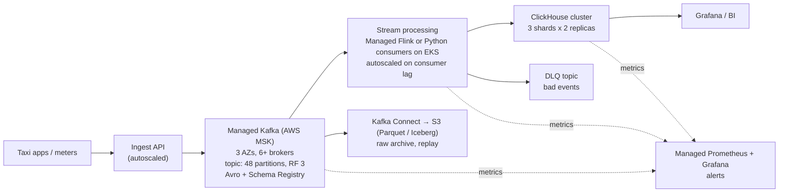

# NYC Taxi Streaming Pipeline (Assignment 2)

Real-time pipeline for NYC Yellow Taxi trips: a daily parquet file is streamed into Kafka, processed in
Python (cleaning + sliding window aggregation), stored in ClickHouse and monitored with Prometheus and Grafana.

```
data/raw (monthly)  →  copy_5min.py  →  data/daily  →  producer  →  Kafka (3 brokers)  →  processor  →  ClickHouse
                                                         │                                  │
                                                         └────────── metrics ───────────────┴──→ Prometheus → Grafana
```

Full diagram and the path of one trip: [docs/architecture.md](docs/architecture.md)

| Part | Technology |
|---|---|
| Message broker | Apache Kafka 3.9, 3 brokers in KRaft mode (no ZooKeeper), Docker Compose |
| Producer / processor | Python 3.11, kafka-python, watchdog, pyarrow |
| Storage / OLAP | ClickHouse 25.8 |
| Monitoring | Prometheus, Grafana, kafka-exporter |

## Quick start

Requirements: Docker Desktop (8 GB memory or more), Git Bash, Python 3.10+, curl.

```bash
bash setup.sh                                   # venv, download 2023-01, start all containers, send 00:00-00:15
.venv/Scripts/python.exe scripts/copy_5min.py   # send the next 4 five-minute files (10 s apart)
```

| What | Where |
|---|---|
| Grafana dashboard | http://localhost:3000 (admin / admin) |
| Prometheus | http://localhost:9090 |
| ClickHouse | `docker exec -it clickhouse clickhouse-client -u admin --password admin` |
| Logs | `logs/producer.log`, `logs/processor.log` (JSON lines), or `docker compose logs -f producer processor` |

All settings (rate, window size, ports, passwords) are in `.env` (copied from `.env.example`).

## How it works

**1. copy_5min.py** splits 2023-01-01 from the monthly file in `data/raw` into 5 minute files by dropoff time
(`data/5min/2023-01-01/`) and copies the next 4 to `data/daily` on every run, 10 seconds apart (written as `.part` and renamed,
so it is never read half-written).

**2. producer.py** (watchdog) sees the new file. If its name is in `data/sent_files.json` it was sent before and is
skipped. Otherwise every row is sent to Kafka as JSON:
- sorted by dropoff time (= event time), at `PRODUCER_RATE` rows per second (10-50)
- key = pickup zone, so all trips of a zone go to the same partition and keep their order
- `acks=all` + idempotent producer: no loss when a broker fails, no duplicates when a send is retried

**3. Kafka**: topic `taxi-trips-stream`, 6 partitions, replication factor 3, `min.insync.replicas=2`.
One broker can be down without losing data or stopping the pipeline.

**4. processor.py** loops over batches (500 trips or 5 seconds):
1. clean each trip (Assignment 1 rules: required fields, pickup on the file's date, dropoff after pickup,
   max 24 h, no negative amounts)
2. insert the good trips into `fact_taxi_trips` and the bad ones, with the reason, into `rejected_trips`
   (`rejected.py`), one insert each per batch
3. add the same batch to the windows in memory: `sliding_window.update()`
4. **trigger, every 5 minutes** (`WINDOW_TRIGGER_MINUTES`): save the windows with `sliding_window.save()`,
   then commit the Kafka offsets

If anything fails (e.g. ClickHouse is down), the processor stops with an error and Docker restarts it.
Everything after the last commit is delivered again and the windows continue from their last save:
nothing is lost (at-least-once). Because of this the consumer lag in Grafana rises for 5 minutes and drops
at each trigger.

**5. sliding_window.py**: trips and revenue per pickup zone in 10-minute windows that start every 5 minutes
(each trip is in 2 windows), by event time.
- watermark = newest dropoff time - 2 minutes, one per partition
- a trip older than the watermark is **late**: it is in the fact table but not counted in windows
- a window that ends before the watermark is **final** and removed from memory
- at every trigger (5 minutes) the open windows are written to `trip_window_agg`; ClickHouse keeps the
  newest version (upsert). At startup the open windows are loaded back, so a restart continues the counts.

**6. ClickHouse** (database `taxi_stream`)

| Table | Content | Engine / duplicates |
|---|---|---|
| `fact_taxi_trips` | one row per clean trip, all columns + source file, Kafka partition/offset | `ReplacingMergeTree`, one row per `trip_id` |
| `rejected_trips` | trips that failed cleaning: raw JSON from Kafka + reason | `ReplacingMergeTree`, one row per Kafka offset |
| `trip_window_agg` | trips, fare, tips, revenue, distance per window and zone | `ReplacingMergeTree(version)` = upsert |
| `v_window_latest` | latest version of each window + average fare and fare per mile | view |

Use `FINAL` (or the view) to read deduplicated rows.

## Monitoring (Grafana dashboard "Taxi Stream Pipeline")

| Panel | Shows |
|---|---|
| Kafka brokers online, Under-replicated partitions | cluster health (3 brokers, 0 under-replicated) |
| Sent / Read / Inserted / Not inserted | totals of all files: sent by the producer, read by the processor, inserted into ClickHouse, rejected by cleaning |
| Late trips (24h) | trips older than the watermark: stored, not counted in windows |
| Waiting in Kafka (consumer lag) | trips not committed yet; drops to 0 at every trigger (5 min) |
| Per file | one row per file: rows in the file, sent, read, inserted, not inserted |
| Throughput | rows/s sent, read and inserted |

## Demo scenarios

| Scenario | Command | What to see |
|---|---|---|
| Stream data | `python scripts/copy_5min.py` (run again for the next 4 files) | per file table and throughput in Grafana, rows in `fact_taxi_trips` |
| Broker failure | `docker stop kafka-2` … `docker start kafka-2` | Kafka brokers online 2, Under-replicated partitions 6, data keeps flowing (`acks=all` needs only 2 copies); back to 3 / 0 after the start |
| ClickHouse down (backpressure) | `docker stop clickhouse` … `docker start clickhouse` | processor restarts, lag grows, then drains to 0, no rows lost |
| Same file again | copy a file from `data/5min` that was already sent into `data/daily` | producer skips it (name in `sent_files.json`) |
| Late events | copy a later file by hand first (e.g. `_0100.parquet` into `data/daily`), then run `copy_5min.py` | the earlier files are behind the watermark: trips are stored, not counted in windows; `processor_late_events_total` goes up |

Useful queries:
```sql
SELECT count() FROM taxi_stream.fact_taxi_trips FINAL;
SELECT * FROM taxi_stream.v_window_latest ORDER BY total_revenue DESC LIMIT 10;
```

## Assumptions

- Event time = dropoff time (the fare is known when the trip ends).
- Historical 2023 data is replayed at 10-50 rows/s; windows use the original timestamps.
- Days are sent in date order. A day older than one already sent is treated as late for the windows.
- At-least-once delivery. Duplicate trips are removed in ClickHouse by `trip_id`; if the processor crashes
  between the window save and the commit, those trips can be counted twice in the windows (rare).
- One processor instance. Window state is restored at startup; several instances would need it per partition.
- Single ClickHouse node locally; replication and sharding are described below.

## Production design: 50,000 events per second



**Sizing.** 50,000 events/s × ~700 bytes of JSON ≈ 35 MB/s in, ×3 replicas ≈ 105 MB/s written in the cluster,
about 3 TB per day before replication. Avro instead of JSON cuts this by roughly 4×.

| Area | Local setup | Production |
|---|---|---|
| Kafka | 3 brokers on one machine | managed Kafka (AWS MSK / Confluent Cloud), 6+ brokers across 3 availability zones, rack awareness, `acks=all`, `min.insync.replicas=2`, retention 3-7 days |
| Partitions | 6 | 48: enough parallel consumers (one partition ~1-5k events/s for a Python consumer) and room to grow; key = pickup zone keeps per-zone order |
| Event format | JSON | Avro/Protobuf with Schema Registry (smaller, schema changes are checked) |
| Producer | one process | many instances, `linger.ms` 20-50 ms, batch 64-256 KB, lz4/zstd compression |
| Processing | one Python processor | Apache Flink (state in RocksDB, checkpoints, exactly-once, watermarks built in) or 20-50 Python consumers on Kubernetes, autoscaled on consumer lag (KEDA) |
| Bad events | stored in `rejected_trips` | dead-letter topic, so they can be inspected and replayed |
| Storage | single ClickHouse node | ClickHouse cluster, 3 shards × 2 replicas, `ReplicatedReplacingMergeTree` + `Distributed` table, inserts of 10k-100k rows (or async inserts), partition by day, TTL to S3 |
| Raw archive | data/raw folder | Kafka Connect S3 sink (Parquet/Iceberg): replay and backfill without the source |
| Monitoring | Prometheus + Grafana in Docker | managed Prometheus + Grafana, alerts on consumer lag, under-replicated partitions, error rate, end-to-end latency (e.g. p95 < 10 s) |
| Security | none (local) | TLS everywhere, SASL/IAM auth, private network, secrets in a secrets manager |

**Why it scales.** Every layer scales out by adding instances: Kafka by partitions and brokers, processing by
consumers (one per partition), ClickHouse by shards. Backpressure stays the same as locally: when a sink is slow,
consumers fall behind, Kafka keeps the events, lag alerts fire and the autoscaler adds consumers.

## Project structure

```
setup.sh                  venv, download data, start all containers
docker-compose.yml        Kafka x3, ClickHouse, producer, processor, kafka-exporter, Prometheus, Grafana
.env.example              all settings
app/producer.py           watches data/daily, sends rows to Kafka
app/processor.py          Kafka -> clean -> fact table -> sliding windows -> commit
app/sliding_window.py     window and watermark logic
app/rejected.py           saves bad trips to rejected_trips
app/common.py             settings and JSON logging
scripts/copy_5min.py      next 4 five-minute files into data/daily
clickhouse/init.sql       tables and view
monitoring/               Prometheus config, Grafana data source and dashboard
docs/architecture.md      architecture diagram
```

## Troubleshooting

- **Git Bash rewrites paths** in `docker exec ... /opt/kafka/...`: run `export MSYS_NO_PATHCONV=1` first.
- **Kafka commands time out after Docker Desktop crashed**: the brokers can get stuck electing a controller.
  Restart them: `docker compose restart kafka-1 kafka-2 kafka-3`.
- **A file is not sent**: its name is already in `data/sent_files.json`; remove it there to send it again.
