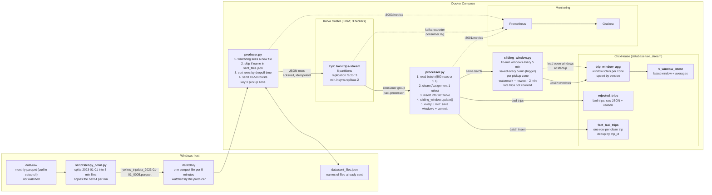

# Architecture: how the data flows

## One trip, step by step

1. `python scripts/copy_5min.py` copies the next 4 five-minute files of 2023-01-01 (split by dropoff time)
   into `data/daily`, e.g. `yellow_tripdata_2023-01-01_0005.parquet`.
2. **producer.py** (watchdog) sees it, checks `sent_files.json`, and sends every row to Kafka as JSON,
   sorted by dropoff time, 10-50 rows per second. Key = pickup zone, so a zone always goes to the same partition.
3. **Kafka** stores each row in one of 6 partitions, copied to 3 brokers.
4. **processor.py** reads a batch, cleans it, inserts the good trips into **fact_taxi_trips**,
   and passes the same batch to **sliding_window.py**.
5. **sliding_window.py** adds each trip to its 2 windows in memory; every 5 minutes (trigger) the windows are upserted into
   **trip_window_agg** and the Kafka offsets are committed.
   Trips older than the watermark are late: they are in the fact table but not in the windows.
6. **Prometheus** collects the metrics of the producer, the processor and Kafka; **Grafana** shows them.
